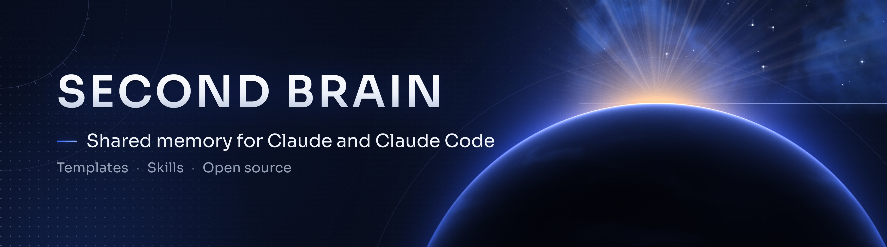

<p align="center">
  
</p>

<p align="center">
  
  
  
</p>

# claude-second-brain

**Un système simple pour que Claude (chat) et Claude Code partagent la même mémoire de travail, sans jamais perdre le fil.**
*A simple setup so Claude and Claude Code share one working memory.*

## ✦ L'idée

Chaque projet vit dans un dossier. Trois petits fichiers suffisent pour que n'importe quelle session (chat ou Claude Code) reprenne exactement où la précédente s'est arrêtée :

| Fichier | Rôle |
|---|---|
| `CLAUDE.md` | Les règles stables : rôle, sécurité, façon de travailler. Lu à chaque session. |
| `STATE.md` | **Où on en est** : objectif, fait, en cours, prochaine action. Réécrit en fin de session (60 lignes max). |
| `DECISIONS.md` | Journal des décisions datées. On ajoute, on n'efface jamais. |

```
Projets/
├── CLAUDE.md            règles communes à tous les projets
├── 01-mon-projet/
│   ├── CLAUDE.md        règles propres au projet
│   ├── STATE.md         où on en est
│   ├── DECISIONS.md     décisions datées
│   ├── fiches/          références
│   └── a_valider/       livrables à valider avant publication
└── ...
```

## ✦ Le protocole

1. **Début de session** : lire `CLAUDE.md` et `STATE.md`, rien d'autre.
2. **Pendant** : une décision importante ? Une ligne dans `DECISIONS.md`.
3. **Fin de session** (« fin de session ») : réécrire `STATE.md`.
4. **Règle du bouton** : Claude prépare, tu valides. Jamais de publication, paiement ou envoi sans accord explicite.

Résultat : peu de tokens dépensés pour reprendre le contexte, et zéro perte quand on change de conversation.

## ✦ Contenu

- [`templates/`](templates) : `CLAUDE.md` commun, `STATE.md`, `DECISIONS.md` à copier.
- [`skills/passation-conversation`](skills/passation-conversation) : skill qui condense une conversation longue en un bloc à coller dans un nouveau chat.
- Pour des PDF soignés : [pdf-luxe](https://github.com/horizonchapter/pdf-luxe).
- Pour automatiser la veille et le suivi : [claude-routines](https://github.com/horizonchapter/claude-routines).
- Pour déléguer à des modèles moins chers : [chef-employe](https://github.com/horizonchapter/chef-employe).

## ✦ Installation

```bash
git clone https://github.com/horizonchapter/claude-second-brain.git
cp -r claude-second-brain/skills/passation-conversation ~/.claude/skills/
cp claude-second-brain/templates/CLAUDE.md  ./Projets/CLAUDE.md
```

Adapte ensuite les modèles à ta situation : ils contiennent des `[À COMPLÉTER]` aux endroits personnels.

## ✦ Licence

MIT.
